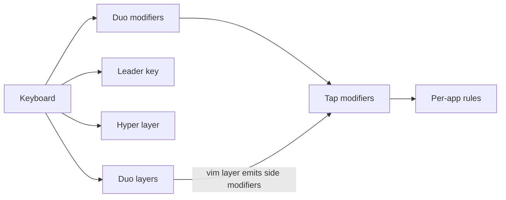

# Karabiner Config

My [Karabiner-Elements](https://github.com/pqrs-org/Karabiner-Elements) config, written in TypeScript with [karabiner.ts](https://github.com/evan-liu/karabiner.ts) and based on [evan-liu's config](https://github.com/evan-liu/karabiner-config/blob/main/karabiner-config.ts).

It turns a standard keyboard into a layered input system where your fingers never leave the home row.

## Docs

- [`user-guide.md`](./user-guide.md): how the patterns work and why.
- [`cheatsheet.md`](./cheatsheet.md): every binding, in tables (generated by `npm run cheatsheet`).

## What's in it

| Pattern | Trigger | What it does |
|:---|:---|:---|
| Duo modifiers | Chord two keys (e.g. `f`+`d`) | Acts as ⌘ ⌃ ⌥ ⇧ and combinations, left or right side |
| Leader key | `l` + `;`, then keys | One-shot commands: launch apps, paste emoji or gitmoji, open links, run Raycast extensions, open System Settings panes |
| Hyper layer | Hold ⇪, then hold a sublayer key | Burst commands: open apps, window management, symbols, digits, movement, media, system controls |
| Duo layers | Hold two keys (e.g. `f`+`;`) | Vim arrows, symbols, digits and delete, snippets |
| System layer | Hold `` ` `` | Mouse warp, sleep, app switch, clear notifications |
| Tap modifiers | Tap a side modifier (`‹⌘`, `›⌥`, …) | Per-app actions such as sidebar, terminal and command palette |
| Window management | `Hyper`/`Meh` + keys | Raycast window layouts (thirds, halves, fourths, displays, desktops) and `Meh`+`1`, which resizes the frontmost window in any app |
| App rules | Automatic per app (skipped by default, see [Usage](#usage)) | Shared back/forward, tab and window navigation |



Per-app rules cover Chrome, Safari, JetBrains IDEs, Zed, VSCode, Slack and Zoom. All of them are listed in `disabled-apps.json`, so `npm run build` skips them until you remove a name from that list or enable the rule from Karabiner's drawer. Hardware rules handle non-Moonlander keyboards and the ZSA Moonlander.

## Requirements

- macOS with [Karabiner-Elements](https://karabiner-elements.pqrs.org/)
- Node 20+, to run the TypeScript config. The repo pins Node 24 in `mise.toml`; with [mise](https://mise.jdx.dev/), run `mise trust` once and `mise install`
- Optional: [Raycast](https://www.raycast.com/) (window management and extensions), [Homerow](https://www.homerow.app/), and a [ZSA Moonlander](https://www.zsa.io/moonlander)

## Usage

```sh
npm install
npm run build      # writes the "Default" Karabiner profile and the app-rule drawer file
npm run update     # update karabiner.ts
npm run cheatsheet # regenerate cheatsheet.md from the config
npm run typecheck
npm run snapshot   # dry run: rewrite snapshot.json, leaves the profile untouched
npm run snapshot:check  # fail if snapshot.json is out of date
```

To skip per-app rules on `build`, list their names in `disabled-apps.json` (e.g. `["slack", "zoom"]`; valid names: `chrome`, `safari`, `jetbrains`, `zed`, `vscode`, `slack`, `zoom`). `snapshot` and `cheatsheet` always include every app. Every `build` also writes all app rules to Karabiner's drawer (`~/.config/karabiner/assets/complex_modifications/karabiner-config-apps.json`), so skipped apps still appear under Complex Modifications → Add predefined rule, where you can enable them one by one. Rules enabled there are copies and are replaced by the next `build`.

`build` overwrites rules in the `Default` profile, so back up your Karabiner config first if you have manual rules.

## Layout

| File | Purpose |
|:---|:---|
| `karabiner-config.ts` | All rules, layers and app definitions. `main()` lists what's loaded |
| `layer-engines.ts` | Leader key and Hyper layer state machines |
| `utils.ts` | Shared helpers: duo and tap modifiers, `appCommons`, Raycast and resize helpers, layer hints (`twoRowHint`) |
| `describe.ts` | Human-readable key and event names, shared by the layer hints and the cheatsheet generator |
| `dry-run.ts` | Runs the config in dry-run mode with every app enabled; used by the snapshot and cheatsheet scripts |
| `snapshot.ts` / `snapshot.json` | Snapshot of the emitted rules, one manipulator per line; run `npm run snapshot` after changing a binding |
| `generate-cheatsheet.ts` | Generates `cheatsheet.md` from the config's dry-run output |
| `disabled-apps.json` | Names of per-app rules to skip when running `npm run build` |
| `links.json` | Data for the leader-key Link namespace |
