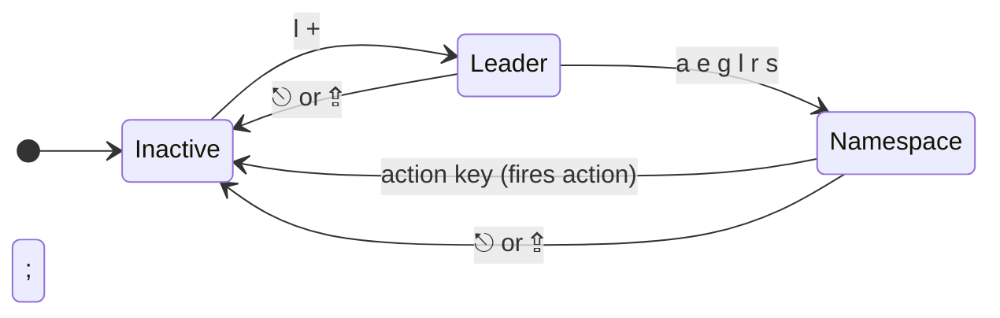
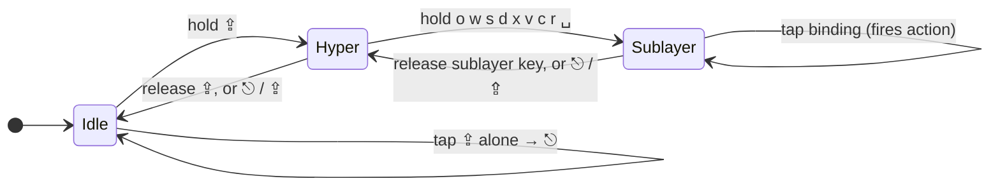

# Karabiner Config — User Guide

A Karabiner-Elements configuration written in TypeScript via [karabiner.ts](https://github.com/evan-liu/karabiner.ts). It turns a standard keyboard into a layered input system: chord-based modifiers, a leader key for namespaced commands, home-row layers for arrows / symbols / digits / snippets, and per-app overrides that ride on top.

The full binding reference lives in [`cheatsheet.md`](./cheatsheet.md). This guide explains the *patterns* the config is built from — once you understand them, every binding in the cheatsheet is self-explanatory.

---

## Prerequisites

- **macOS** with [Karabiner-Elements](https://karabiner-elements.pqrs.org/) installed.
- **Node** to run the TypeScript config and emit JSON into Karabiner's profile.
- The [`karabiner.ts`](https://github.com/evan-liu/karabiner.ts) library (declared in `package.json`).
- *Optional:* a [ZSA Moonlander](https://www.zsa.io/moonlander) keyboard — there is dedicated handling for `vendor_id: 12951, product_id: 6505`. Everything else falls under the "Non-Moonlander Keyboards" rule.
- *Optional:* [Raycast](https://www.raycast.com/) with the Window Management extension and [Homerow](https://www.homerow.app/) — several rules invoke them.

To apply the config: `npm install`, then `npm run build` (`tsx karabiner-config.ts`). It calls `writeToProfile('Default', …)` and writes directly into the Karabiner profile. `npm run snapshot` does a dry run (`KARABINER_DRY_RUN=1`) that rewrites `snapshot.json` without touching the profile; `npm run snapshot:check` fails if the snapshot is out of date.

---

## The six core patterns

Everything in this config is built from six patterns. Each section below explains one pattern with a single example; the cheatsheet has the full enumeration.

### 1. Duo modifiers — chord two keys to fire a modifier

Instead of reaching for ⌘ with your thumb, you press two adjacent keys *simultaneously* and the chord fires the modifier. While held, the chord behaves as the modifier; tapped, both keys type as themselves.

```ts
'⌘': ['fd', 'jk'],
'⌃': ['fs', 'jl'],
'⌥': ['fa', 'j;'],
'⇧': ['ds', 'kl'],
```

Pressing `f` + `d` together (within 50 ms — see [Tuning knobs](#tuning-knobs)) sends ⌘. Hold them and ⌘ stays active for the next key. Type `f` then `d` separately and you get the literal letters.

Combined modifiers chord differently:

```ts
'⌘⇧': ['gd', 'hk'],
'⌃⇧': ['gs', 'hl'],
'⌘⌥⌃': ['vz', 'm/'],
```

The implementation lives in `utils.ts:duoModifiers`. It registers each chord in both orders (`fd` and `df`) and uses `mapSimultaneous` with `key_down_order: 'strict'`, a 150 ms hold threshold, and a 150 ms tap-alone timeout. If you press both keys but neither is held past 150 ms, both letters are emitted unchanged.

**Why this matters:** your fingers never leave home row to reach a modifier, and the most-used modifiers get the easiest chords (⌘ → index+middle, ⌃ → index+ring, ⌥ → index+pinky, ⇧ → middle+ring). Left-hand chords emit left-side modifiers (`‹⌘`) and right-hand chords emit right-side ones (`›⌘`).

### 2. Leader key — `l` + `;` for namespaced commands

Pressing `l` and `;` simultaneously enters **leader mode**. A notification shows the available namespaces. Press a namespace key to enter it; press an action key to fire and exit; press ⎋ or ⇪ to abort.

```
 l + ;  ──▶  Leader mode      notification: a_App e_Emoji g_Gitmoji l_Link r_Raycast s_SystemSetting
   └─ a  ──▶  App namespace   notification: c_GoogleChrome e_Zed f_Finder …
        └─ c  ──▶  launch Google Chrome (and exit leader mode)
```



The implementation is `layer-engines.ts:createLeaderLayer` (configured by `rule_leaderKey` in `karabiner-config.ts`), a small state machine driven by a `leader` variable:

- `0` (inactive) — only the `l;` chord (250 ms window) matches, sets `leader = 1`, shows top-level hint.
- `1` (leader) — namespace keys (`a` `e` `g` `l` `r` `s`) set `leader = <key>` and show the namespace's hint.
- `<namespace>` — action keys fire the action and reset `leader = 0`.
- ⎋ or ⇪ in any non-zero state aborts and dismisses the notification.

Six namespaces ship out of the box:

| Namespace | What it does | Action |
|---|---|---|
| `a` App | Launch / focus an app | `toApp` |
| `e` Emoji | Paste an emoji | `toPaste` |
| `g` Gitmoji | Paste a gitmoji ([gitmoji.dev](https://gitmoji.dev)) | `toPaste` |
| `l` Link | Open a URL from `links.json` | `to$('open …')` |
| `r` Raycast | Run a Raycast extension | `raycastExt` |
| `s` SystemSetting | Open a System Settings pane | `toSystemSetting` |

The Link namespace is data-driven via `links.json` — add an entry like `"y": "https://youtube.com"` and `l;` `l` `y` will open YouTube.

### 3. Hyper layer — hold ⇪ for app / window / system commands

A second namespaced command system, but driven by *holding* keys rather than chording them. Hold ⇪ (Caps Lock) to enter Hyper; the notification shows the available sublayers. While ⇪ is still held, hold a sublayer key (e.g. `o`) and tap a letter to fire the action — you can fire several actions before releasing. Tap ⇪ alone (no hold) → ⎋. ⎋ or ⇪ pressed inside a layer state aborts it.

```
 hold ⇪          ──▶  Hyper            notification: o_Open w_Window s_Symbol d_Digit x_System v_Move c_Music r_Raycast ␣_Symbol2
   └─ + o        ──▶  Open sublayer    notification: Open: 1 g c v d s e n t z m f i p a
        └─ tap g ──▶  launch Google Chrome (⇪ and o stay held — fire more actions)
```



Nine sublayers ship out of the box:

| Sublayer | What it does |
|---|---|
| `o` Open | Launch / focus an app |
| `w` Window | Window halves, display switching, window/tab cycling, zoom in/out |
| `s` Symbol | Same mapping as the Symbol duo-layer (`! @ # $ % ^ & * ( )`, brackets, `_ +`) |
| `d` Digit | Same mapping as the Digit duo-layer (numpad, `+ - * /`, ⌫ family) |
| `x` System | Volume, brightness, lock, DND, dark mode, camera |
| `v` Move | Arrow / page navigation, app-specific motion chords |
| `c` Music | Play / pause / forward / rewind |
| `r` Raycast | Calendar, dictionary, emoji, gitmoji, snippets, clipboard |
| `␣` Symbol2 | Full-alpha-block symbol layer: shifted-number row on QWERTY, brackets/pipe/minus/equals/backtick/tilde/underscore on home row, digits 1–0 on ZXCVB row |

The Symbol and Digit sublayers duplicate their duo-layer counterparts so the same bindings are reachable either by chord (`s + ;` / `d + ;`) or by hold (⇪ + `s` / ⇪ + `d`).

The implementation lives in `layer-engines.ts:createHyperLayer`. Holding ⇪ activates a `hyper` variable; holding a sublayer key activates `hyper_sub_<key>`, gated on `hyper = 1` *and* every other `hyper_sub_*` being `0` so two sublayers can't fire simultaneously. Tap ⇪ alone falls through to `configKey(m => m.toIfAlone(toKey('⎋')), true)`, preserving the Caps-as-Escape behavior.

**How this differs from the leader.** The leader is *chord then tap*: chord `l + ;`, release, then tap a namespace key, then tap an action key — a tap sequence that fires once. Hyper is *hold while typing*: keep ⇪ held, keep a sublayer key held, and tap action keys repeatedly. Use the leader for one-shot commands; use Hyper for commands you fire in bursts (e.g. window management while triaging tabs).

### 4. Duo layers — hold two keys to enter a temporary layer

A layer remaps the entire keyboard while it's active. Four duo-layers are defined; each is entered by *holding* two specific keys together and exited the moment either key is released. Vim, Symbol and Digit use a 250 ms activation window (`.threshold(250)`); Snippet uses the 50 ms global default.

| Layer | Trigger | Purpose |
|---|---|---|
| **Vim** | `f` + `;` | h/j/k/l arrows, modifier passthrough |
| **Symbol** | `s` + `;` | `! @ # $ % ^ & * ( )`, brackets, `_ +` on home row |
| **Digit** | `d` + `;` | numpad layout (0–9), `+ - / *`, F1–F9, ⌥⌫ / ⌘⌫ |
| **Snippet** | `z` + `x` | Paste arrows / modifiers as glyphs, code snippets |

There is also one regular (non-duo) layer:

| Layer | Trigger | Purpose |
|---|---|---|
| **System** | hold `` ` `` (backtick) | Mouse warp, sleep, app switch, clear notifications |

The Vim, Symbol and Digit layers have a `notification(...)` hint string showing their layout (e.g. the vim layer shows `← ↓ ↑ →` above `H J K L`). The hints are generated from the same mapping tables the layers use (`twoRowHint` in `utils.ts`), so they can't drift from the bindings.

A small but important detail: inside the vim layer, holding `;`/`d`/`s`/`a` produces *side-specific* modifiers (`›⇧` `‹⌘` `‹⌃` `‹⌥`). This means the vim layer can hand off to the per-app tap-modifier rules (next pattern) without leaving home row.

### 5. Tap-modifiers — tap a side modifier to fire an action

Per-app rules use `utils.ts:tapModifiers`, which exploits `karabiner.ts`'s `toIfAlone` to give every side modifier a dual personality:

- **Hold** — behaves as the modifier (so ⌘C, ⌘V, etc. still work).
- **Tap and release** — fires a one-shot action defined per app.

The convention used throughout the config:

| | Left side (`‹`) | Right side (`›`) |
|:---:|:---|:---|
| **⌘** | show / hide left UI (sidebar, file tree) | show / hide right UI (terminal, web inspector, right panel) |
| **⌥** | run current task / re-run / refresh | command palette (⌘K, ⌘⇧A, ⌘⇧P) |
| **⌃** | run list / debug | history / recent files |

Concrete example from `app_zed`:

```ts
tapModifiers({
  '‹⌘': toKey('⎋', '⌘⇧'),  // closeAllDocks
  '‹⌥': toKey('t', '⌥'),    // task::Rerun
  '‹⌃': toKey('t', '⌥⇧'),   // task::Spawn
  '›⌘': toKey('`', '⌃'),    // terminal
  '›⌥': toKey('a', '⌘⇧'),   // command
  '›⌃': toKey('p', '⌘'),    // fileFinder
})
```

So in Zed, **tap right-⌘** to open the terminal, **tap left-⌘** to close all docks. The same physical taps mean structurally similar things in every app — the cheatsheet has the per-app mappings.

### 6. Per-app overrides — `ifApp` rules layered on top

Each app gets a `rule(name, ifApp(bundleId)).manipulators(appCommons({ … }))`. `utils.ts:appCommons` composes three reusable nav mixins plus your own bindings:

```ts
historyNavi()  // ⌃H ⌃L → ⌘[ ⌘]   (back/forward)
tabNavi()      // ⌥H ⌥L → ⌘⇧[ ⌘⇧] (prev/next tab)
switcher()     // ⌘⌥⌃H ⌘⌥⌃L → ⌃⇧⇥ ⌃⇥ (prev/next window or workspace)
```

Options are `history`, `tab`, `switcher` (booleans), `prependExtras`, `taps` (tap-modifiers) and `appendExtras`, always emitted in that order. A tap value is either an event or `[event, description]`; the description appears in the generated cheatsheet. A typical app rule:

```ts
rule('Chrome', ifApp('^com.google.Chrome$')).manipulators(
  appCommons({
    history: true,
    tab: true,
    switcher: true,
    taps: { '‹⌥': [toKey('r', '⌘'), 'Refresh the page'], … },
    appendExtras: [map('⎋', '⌘').to('⎋', '⌘⇧')],
  }),
)
```

The `Meh+1` binding deserves special mention. Meh is a 3-modifier combo (⌥⌃⇧, generated by the non-Moonlander keyboard rule from `›⌘+›⇧`). It is a global binding (in the Window Management rule) that runs `toResizeWindow`, an `osascript` that sizes the frontmost app's first window to a full-height column on the main screen. Geometry is relative to the screen: the default is the first quarter-width column below the widget area (`x: 0`, `w: 1/4`, `top: 220` px), and the window runs to the bottom of the screen. Slack overrides it with its own `x`/`w`/`top` in its app rule.

The configured apps are: Chrome, Safari, JetBrains IDEs (any), Zed, VSCode, Slack, Zoom.

---

## Hardware notes

### Non-Moonlander keyboards (Apple and any other)

`keyboard_nonMoonlander` matches `vendor_id: 12951.unless()` — i.e. anything that isn't a Moonlander.

| Input | Output |
|---|---|
| Tap ⇪ | ⎋ |
| Hold ⇪ | Enter the [Hyper layer](#3-hyper-layer--hold--for-app--window--system-commands) |
| ⇧ + ⇪ | ⇪ (real Caps Lock) |
| ›⌥ + ›⇧ | Hyper (⌘⌥⌃⇧) |
| ›⌘ + ›⇧ | Meh (⌥⌃⇧) |

Caps Lock pulls double duty: tap-alone is the well-known vim Escape trick (delivered via `configKey(m => m.toIfAlone(toKey('⎋')), true)` on the Hyper layer rule), and a hold opens the Hyper sublayer system. The chord-built **Hyper** (⌘⌥⌃⇧) and **Meh** (⌥⌃⇧) modifiers are unrelated to the Hyper *layer* — they're 4-/3-modifier combos used by the global Raycast window-management bindings (next section).

### Moonlander

`keyboard_moonlander` matches the exact vendor+product id.

| Input | Output |
|---|---|
| ⇧ + ⎋ | ⇪ |
| Tap ‹⌃ | ⌘⇧␣ (next input source — language switch) |

The Moonlander's QMK firmware handles Caps Lock differently, hence the alternate path.

---

## Global bindings worth knowing

Two rules apply globally regardless of app:

**Raycast window management** (`windowManagement`) — Hyper + arrow keys move windows between displays / desktops; Hyper + digits / Meh + digits resize to thirds, halves, fourths, center, etc. The full set is in the cheatsheet.

**Homerow** (`app_homerow`) — chord `f + j` to click and `f + k` to scroll, mapping to Hyper+␣ and Hyper+⏎ which Homerow listens for. This makes Homerow's mouseless navigation reachable from the home row without a dedicated trigger key.

`f + j` and `f + k` are deliberately not used by any duo modifier, so they're free for Homerow.

---

## Tuning knobs

All thresholds are in `karabiner-config.ts`:

```ts
{
  'basic.simultaneous_threshold_milliseconds': 50,   // duo-modifier window
  'duo_layer.threshold_milliseconds': 50,            // duo-layer activation window
  'duo_layer.notification': true,                    // show layer hints
}
```

Plus three per-rule or per-layer values:

- **Duo modifier hold** — `to_if_held_down_threshold_milliseconds: 150` and `to_if_alone_timeout_milliseconds: 150` (in `utils.ts:duoModifiers`). Below 150 ms = tap (emit letters); above 150 ms = hold (stay as modifier).
- **Leader chord** — 250 ms simultaneous window for `l + ;` (in `rule_leaderKey`).
- **Duo-layer activation window** — each duo-layer's `.threshold(250)` overrides the 50 ms global: vim, symbol, and digit layers use 250 ms; the snippet layer uses the default.

If duo modifiers feel "sticky" (chords firing when you didn't mean them) lower the 50 ms threshold; if they feel "missy" (chords not registering) raise it. The 150 ms hold threshold tunes how long you must hold before the chord becomes a modifier rather than two letters.

---

## Files

- `karabiner-config.ts` — all rules, layers, and app definitions. Top-level `main()` lists what's loaded.
- `layer-engines.ts` — `createLeaderLayer` and `createHyperLayer`, the state machines behind the leader key and Hyper layer.
- `utils.ts` — `duoModifiers`, `tapModifiers`, `appCommons`, `historyNavi`, `tabNavi`, `switcher`, `toResizeWindow`, `raycastExt`, `raycastWin`, `toClearNotifications`, `toSystemSetting`, `twoRowHint`, `eventLabel`, `mapValues`.
- `describe.ts` — human-readable key and event names, shared by the layer hints and the cheatsheet generator.
- `generate-cheatsheet.ts` — `npm run cheatsheet` regenerates `cheatsheet.md` from the config's dry-run output.
- `links.json` — leader-key Link namespace data.

Adding a new binding means editing one of these and re-running the script — Karabiner picks up the new profile JSON immediately.
